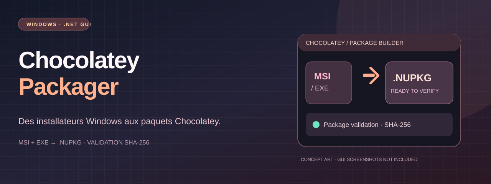

<div align="center">



# Chocolatey Packager — générateur graphique de packages Chocolatey pour Windows

**Chocolatey package builder avec interface graphique Windows : convertissez un installateur MSI ou EXE en package `.nupkg`, sans écrire de scripts PowerShell.**

[](https://github.com/neosoda/ChocolateyPackager)


**Français** · [English](README.en.md) · [Télécharger la bêta](https://github.com/neosoda/ChocolateyPackager/releases/tag/v0.4.0-beta.1) · [Documentation](docs/EXECUTABLE.md)

</div>

| 🧩 **Créer** | 🔎 **Contrôler** | 📦 **Distribuer** |
| :--- | :--- | :--- |
| Importez un MSI/EXE et préparez les métadonnées nécessaires. | Vérifiez le package et les empreintes SHA-256. | Exportez un `.nupkg` pour votre dépôt Chocolatey interne. |

> La bannière est une **illustration conceptuelle**, pas une capture réelle de l'interface WinForms.

Vous cherchez **comment créer un package Chocolatey à partir d'un EXE ou d'un MSI** ? Chocolatey Packager est un créateur de paquets Chocolatey avec interface graphique (GUI) pour Windows 10, Windows 11 et Windows Server. Sélectionnez l'installateur, vérifiez les informations et les paramètres silencieux proposés, puis générez un fichier `.nupkg` pour votre dépôt local ou réseau. **Chocolatey n'est pas nécessaire sur le poste de création** ; il reste requis sur les postes qui installent le paquet.

## Télécharger ChocolateyPackager.exe — v0.4.0-beta.1

La version bêta est disponible sous la forme de **ChocolateyPackager.exe**, une application graphique compilée en **C# / .NET 10 (WinForms)**. Elle crée et valide des packages Chocolatey directement en .NET, **sans lancer les scripts PowerShell du dépôt** et sans dépendance à installer sur le poste utilisateur une fois l'EXE construit.

**[Télécharger directement ChocolateyPackager.exe (https://github.com/neosoda/ChocolateyPackager/releases/tag/v0.4.0-beta.1)](https://github.com/neosoda/ChocolateyPackager/releases/download/v0.4.0-beta.1/ChocolateyPackager.exe)** — [Release GitHub et SHA-256](https://github.com/neosoda/ChocolateyPackager/releases/tag/v0.4.0-beta.1). Le binaire Windows x64 a été compilé et testé automatiquement depuis `main` ([workflow de publication](https://github.com/neosoda/ChocolateyPackager/actions/runs/44770344960)). Les installations réelles doivent encore être validées en VM.

Documentation et commande de compilation : **[Créer l'EXE unique et le tester](docs/EXECUTABLE.md)**.

L'ancienne application PowerShell (`Start.cmd`) reste provisoirement disponible en repli pour ne pas interrompre les utilisateurs tant que la version C# n'a pas été validée.

## Pourquoi utiliser un générateur de package Chocolatey avec interface graphique ?

Pour les administrateurs Windows, les intégrateurs et les équipes de déploiement, l'objectif est de **préparer des paquets reproductibles** à partir d'installateurs existants, sans rédiger entièrement les scripts à la main. Les paramètres silencieux proposés doivent être **vérifiés en environnement de test** avant une diffusion à grande échelle.

## Fonctionnalités

- Interface graphique WinForms, sélection de fichier ou glisser-déposer.
- Lecture des propriétés MSI et analyse statique de signatures EXE, **sans exécuter les installateurs**.
- Suggestions de paramètres silencieux pour MSI, Inno Setup, NSIS, WiX Burn et certains installateurs connus. Les cas incertains sont signalés.
- Création d'un paquet autonome avec installateur embarqué, manifeste `.nuspec` et `chocolateyInstall.ps1`.
- Contrôles SHA-256 à la copie et après création du paquet.
- Sortie dans un dossier local ou un partage réseau, sans écraser un paquet existant.

**Prérequis :** Windows 10, 11 ou Server, et Windows PowerShell 5.1. Pas besoin de Chocolatey, NuGet, Python ou Docker pour *créer* les paquets.

## Validation des packages Chocolatey et édition des métadonnées

L'interface permet désormais de renseigner **l'éditeur, la description et l'URL HTTPS** dans le manifeste NuSpec, et d'afficher l'**UpgradeCode** MSI lorsqu'il existe.

Avant la publication dans le dossier choisi, le moteur appelle `PackageValidator.ps1` : vérification de la relation NuGet, du manifeste XML, de la syntaxe PowerShell, de la structure et du SHA-256 du binaire embarqué. Les erreurs bloquent la création ; un bouton de l'interface permet de valider un `.nupkg` existant.

Pour une validation en ligne de commande, sans exécuter l'installateur :

```powershell
powershell.exe -NoProfile -ExecutionPolicy Bypass -File ".\Validate-Package.ps1" -PackagePath "C:\Packages\exemple.1.0.0.nupkg"
```

Voir [Validation et tests sur VM](docs/VALIDATION.md) et [Références et licences](docs/REFERENCES.md). **Ces fonctionnalités nécessitent encore une validation de bout en bout sur Windows** ; un contrôle statique n'est pas un test d'installation réel.

## Créer un package Chocolatey depuis un EXE ou un MSI (version historique par scripts)

1. Téléchargez [Chocolatey Packager pour Windows (ZIP du dépôt)](https://github.com/neosoda/ChocolateyPackager/archive/refs/heads/main.zip) et extrayez-le dans un dossier.
2. Double-cliquez sur **`Start.cmd`**.
3. Sélectionnez un fichier `.msi` ou `.exe`.
4. Vérifiez l'identifiant, la version, les arguments silencieux et le répertoire de sortie.
5. Cliquez sur **Créer le paquet .nupkg**.

Le paquet généré suit le format `identifiant.version.nupkg`.

### Exemple

Avec l'installateur `Everything-1.4.1.1032.x64-Setup.exe`, l'application peut proposer l'identifiant `everything`, la version `1.4.1.1032` et l'argument `/S`. Le fichier obtenu est `everything.1.4.1.1032.nupkg`.

L'argument reste à confirmer avec la documentation de l'éditeur et par un test d'installation.

## Tester et valider un fichier `.nupkg` Chocolatey

Le projet contient un test de structure qui n'installe rien :

```powershell
powershell.exe -NoProfile -ExecutionPolicy Bypass -File ".\SelfTest.ps1"
```

Pour valider **l'installation réelle**, utilisez une machine Windows de test avec Chocolatey :

```powershell
choco install everything --version 1.4.1.1032 --source="C:\Packages" -y --no-progress
```

Adaptez le dossier et le nom du paquet. Contrôlez le résultat, les journaux, puis les scénarios de mise à jour et de désinstallation avant toute diffusion.

## Fichiers du projet

```text
Start.cmd                 Lance l'interface
ChocolateyPackager.ps1    Interface graphique
InstallerDetector.ps1     Analyse MSI / EXE
PackageBuilder.ps1        Génération et vérification des .nupkg
PackageValidator.ps1      Validation statique des packages
Validate-Package.ps1      Vérification d'un .nupkg en ligne de commande
SelfTest.ps1              Tests structurels non destructifs
QUICKSTART.txt            Aide de démarrage FR/EN
```

Le paquet contient notamment `identifiant.nuspec`, `tools/chocolateyInstall.ps1`, l'installateur embarqué et `tools/packager-info.json`.

## Questions fréquentes sur la création de packages Chocolatey

**Comment convertir un installateur EXE ou MSI en package Chocolatey ?** Ouvrez `Start.cmd`, sélectionnez le fichier dans l'interface, contrôlez l'identifiant, la version et les arguments, puis cliquez sur **Créer le paquet .nupkg**.

**Faut-il installer Chocolatey pour créer un paquet ?** Non. Windows PowerShell 5.1 suffit pour générer le package. Chocolatey est nécessaire sur la machine où le paquet sera installé.

**Les arguments d'installation silencieuse EXE sont-ils garantis ?** Non. Ils sont suggérés à partir de signatures reconnues ou du fournisseur, et doivent être testés dans une VM Windows avant tout déploiement.

**Est-ce utilisable pour un déploiement logiciel en entreprise ou en établissement scolaire ?** Le package peut être enregistré sur un dossier local ou un partage réseau ; vérifiez la compatibilité, les droits d'accès et la licence de redistribution avant de le diffuser.

Pour approfondir : [documentation officielle de création des packages Chocolatey](https://docs.chocolatey.org/en-us/create/create-packages/), [validation des packages](docs/VALIDATION.md) et [version anglaise du README](README.en.md).

## Limites et points à tester

- **Un EXE n'a pas de paramètre silencieux universel.** Une signature d'installateur permet une suggestion, pas une garantie. Si le moteur est inconnu, il faut vérifier la documentation de l'éditeur.
- Les installateurs qui téléchargent des fichiers pendant leur exécution nécessitent toujours une connexion réseau : les intégrer dans un `.nupkg` ne les rend pas autonomes.
- Le projet vérifie la **structure et l'intégrité** du paquet, pas la réussite d'une installation. Les tests Windows + Chocolatey restent nécessaires.
- Les scripts de désinstallation spécifiques à chaque logiciel ne sont pas encore générés automatiquement.
- Vérifiez les licences et les droits de redistribution avant de partager un paquet contenant un installateur tiers.

## Suite du projet

- Tests d'installation Windows automatisés pour plusieurs moteurs d'installation.
- Gestion de la désinstallation et des mises à jour.
- Détection plus précise des arguments avec références et indicateurs de confiance.
- Prévisualisation des scripts et publication vers un dépôt Chocolatey/NuGet.

Pour signaler un problème ou proposer une amélioration : [GitHub Issues](https://github.com/neosoda/ChocolateyPackager/issues).

## Licence et réutilisation

Le **code original** de ChocolateyPackager est proposé sous **Apache License 2.0 + Commons Clause 1.0** (licence *source-available*, **non reconnue comme open source**). Voir [LICENSE](LICENSE).

L'utilisation personnelle, l'auto-hébergement non commercial et les modifications sont autorisés dans les limites du texte de licence. La revente du logiciel ou d'un service payant tirant **entièrement ou substantiellement** sa valeur de ses fonctionnalités nécessite une autorisation écrite du titulaire des droits. **La Commons Clause ne prohibe pas tous les SaaS commerciaux** : les produits apportant une valeur substantielle supplémentaire peuvent être autorisés.

Les logiciels, bibliothèques, contenus et installateurs de tiers restent soumis à **leurs propres licences**, qui ne sont pas remplacées par celle du projet.

<sub>Projet indépendant, sans affiliation avec Chocolatey Software. Version **0.4.0-beta.1** (EXE autonome), scripts historiques v0.3.0 : à valider sur machine de test avant tout déploiement.</sub>